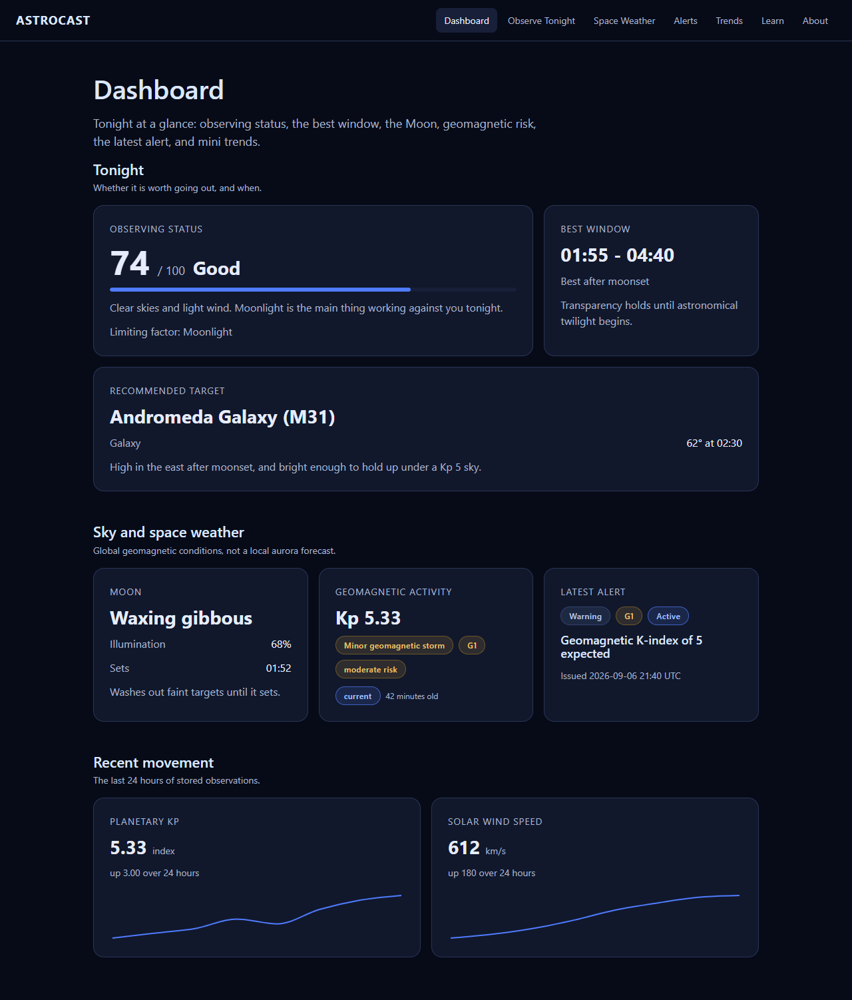
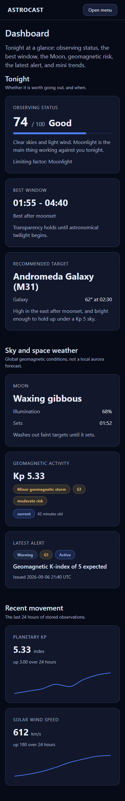

# Week 4 UI Structure

Week 4 turned the single Week 1 forecast view into a seven-page platform UI. Layouts were built
against mock data shaped exactly like the Week 3 API responses, so Week 5 can swap the data source
without reshaping any component. The props of every shared component are documented in
[ui-components.md](ui-components.md).

## Screenshots

Captured in headless Chrome on Day 7. Observe Tonight shows a live forecast for Boston; every other
page is on sample data.

| Desktop, 1280px | Mobile, 390px |
| --- | --- |
|  |  |

| Page | Desktop | Mobile |
| --- | --- | --- |
| Dashboard | [dashboard-desktop.png](screenshots/week-4/dashboard-desktop.png) | [dashboard-mobile.png](screenshots/week-4/dashboard-mobile.png) |
| Observe Tonight | [observe-tonight-desktop.png](screenshots/week-4/observe-tonight-desktop.png) | |
| Space Weather | [space-weather-desktop.png](screenshots/week-4/space-weather-desktop.png) | |
| Alerts | [alerts-desktop.png](screenshots/week-4/alerts-desktop.png) | [alerts-mobile.png](screenshots/week-4/alerts-mobile.png) |
| Alert detail | [alert-detail-desktop.png](screenshots/week-4/alert-detail-desktop.png) | |
| Trends | [trends-desktop.png](screenshots/week-4/trends-desktop.png) | [trends-mobile.png](screenshots/week-4/trends-mobile.png) |
| Learn | [learn-desktop.png](screenshots/week-4/learn-desktop.png) | |
| Navigation menu | | [navigation-mobile.png](screenshots/week-4/navigation-mobile.png) |

## Routes

| Path | Page | Data |
| --- | --- | --- |
| `/` | Dashboard | Sample. Its space-weather cards and mini trends are derived from the same sample data as the Space Weather, Alerts, and Trends pages, so the pages agree. |
| `/observe-tonight` | Observe Tonight | **Live** forecast from `/forecast` and **live** space weather from `/api/space-weather/current`. The hourly table and score breakdown are sample data, and Moon, darkness, and object scores are placeholders. |
| `/space-weather` | Space Weather | Sample, shaped like `/api/space-weather/current` and `/api/space-weather/risk`. |
| `/alerts` | Alerts | Sample, shaped like `/api/space-weather/alerts`. Filters live in the URL. |
| `/alerts/:alertId` | Alert detail | Sample, shaped like `/api/space-weather/alerts/{id}`. |
| `/trends` | Trends | Sample, shaped like `/api/space-weather/trends/kp` and `/trends/solar-wind`. |
| `/learn` | Learn | Static content in `data/concepts.ts`. |
| `/about` | About | Still the Day 1 stub. The roadmap gives it no content in Week 4. |
| `*` | Not found | |

## Layout

Every route renders inside `layout/AppShell.tsx`:

```text
AppShell
|-- Skip to main content link (visible on focus)
|-- header (sticky)
|   |-- AstroCast brand link
|   `-- PrimaryNav
|       |-- toggle button (below 900px)
|       `-- one list of links, shown as a bar or as a menu
`-- main#main-content
    `-- .page-container (1000px maximum)
        `-- the route's page
```

`PrimaryNav` renders a single list for both desktop and mobile, built from
`layout/navigation.ts`, so the two can never disagree. Below 900px the list collapses behind a
toggle. Choosing a link or pressing Escape closes it.

Every page shares one shape:

```text
section.page
|-- h1
|-- p.page-intro
`-- div.page-sections
    |-- PageSection (title, description, optional action)
    |   `-- a .ui-grid of cards, a list, a table, or a chart
    `-- ...
```

## Source layout

```text
frontend/src/
|-- App.tsx                    route table
|-- layout/                    AppShell, PrimaryNav, navigation list
|-- pages/                     one component per route
|-- components/
|   |-- ui/                    shared primitives, tokens in use, layout and type classes
|   |-- dashboard/             Dashboard cards
|   |-- observe/               score readout, hourly table, score breakdown
|   |-- spaceWeather/          risk card, explanation panel
|   |-- alerts/                filters, list item, badges, filter logic
|   |-- trends/                TrendLineChart
|   |-- learn/                 concept card
|   |-- SpaceWeatherCard.tsx   the live card on Observe Tonight
|   `-- PageState.tsx          page-level loading, error, and empty contract
|-- data/                      sample data mirroring the API, and Learn content
|-- utils/format.ts            UTC timestamps and source labels
`-- api/astrocastApi.ts        the two live calls
```

Pages compose rather than hold reusable markup. `pages/Dashboard.tsx` is about 90 lines of layout,
and each of its seven cards is its own component in `components/dashboard/`. The longest page,
Observe Tonight, is mostly the Week 1 state handling it inherited.

## Data: live and sample

The sample modules mirror the backend contracts rather than approximating them: snake_case fields,
ISO timestamps, the risk engine's real rule IDs, and caveat sentences copied word for word from
`backend/services/explanation_service.py`.

| Module | Mirrors | Used by |
| --- | --- | --- |
| `data/mockSpaceWeather.ts` | current conditions, risk, alert list and detail | Space Weather, Alerts, alert detail, Dashboard |
| `data/mockTrends.ts` | Kp and solar-wind trends | Trends, Dashboard mini trends |
| `data/mockDashboard.ts` | nothing yet: observing status, best window, Moon, target | Dashboard |
| `data/mockObserveTonight.ts` | nothing yet: hourly conditions and score components | Observe Tonight |

The last two have no backend counterpart. The backend already fetches 48 hours of hourly weather
and already computes the per-factor score penalties, but it discards both before responding. This
is recorded in `docs/backlog.md`, because Week 5 cannot wire those sections until they are exposed.

Timestamps from NOAA are shown in UTC in the same `2026-09-06 21:40 UTC` format the backend uses
inside its explanation sentences, so a field and the sentence beneath it never disagree.

## Styling

- `index.css` defines the design tokens. The palette is dark-only.
- `components/ui/ui.css` holds the primitives and the shared layout and type classes.
- Each feature stylesheet holds only layout specific to that feature.
- Every text colour pair in use meets WCAG AA, measured on Day 7: body text 16.6:1 on the page
  and 14.9:1 on cards, secondary text 8.5:1, tone badges 7.4–8.4:1. Button labels were the one
  failure, at 3.7:1, and now sit on a darker `--color-action` blue at 5.2:1.
- Colours, type sizes, spacing, and radii come from tokens. The literal values left are dimensions
  with no token — chart heights, meter thickness, minimum column widths — and the font sizes and
  tooltip radius Recharts takes as props rather than CSS.

## Responsive behaviour

| Width | Change |
| --- | --- |
| Below 900px | Navigation collapses behind a toggle, `.ui-span-2` cards drop to one column, headings step down a size. |
| Below 600px | Alert filters stretch to full width. |
| Any width | Card grids fit as many 240px columns as the space allows. Tables scroll inside their own region, never the page. |

On Day 7 every route was measured at 320, 390, 768, 1024, and 1440px for any element crossing the
viewport edge. The only failure was at 320px, where the city search input's intrinsic width pushed
the Check Sky button off-screen; that is fixed. Charts were checked separately in headless Chrome by
loading each chart page at 1440px and narrowing it to 320px: the Dashboard sparklines went from 442
to 238px and the Trends charts from 950 to 238px, with no sideways scroll.

## Keyboard and screen readers

- A skip link is the first tab stop.
- Every interactive element shows a 2px `#8ab4ff` focus ring through `:focus-visible`.
- After navigating, the page scrolls to the top and focus moves to the main content, as a full page
  load would. Before this, a page opened at the previous page's scroll position and focus fell back
  to the body.
- Every form control has a label. The city search label is visually hidden.
- Scrollable tables are focusable regions, so they can be scrolled from the keyboard.
- Each chart is one image named by a text summary, with a data table beneath it. Recharts' own
  keyboard layer is turned off, because it put a focusable element inside that image.
- Each `PageSection` is a region named by its heading.
- The alert count and loading states announce changes politely.
- Meters are decorative and hidden from assistive technology, since the number is always beside them.

## Known gaps

- About is still a stub.
- The live `SpaceWeatherCard` formats its observation time with `toLocaleString`, so it differs by
  machine and from the UTC format used elsewhere. It also still renders the flat `explanation`
  string rather than `explanation_detail`. Both belong with the Week 5 integration.
- The production bundle is 642 kB, 193 kB gzipped, mostly Recharts. Week 7 covers performance.
- The hourly table's scroll region is a tab stop even on desktop, where it does not need to scroll.
